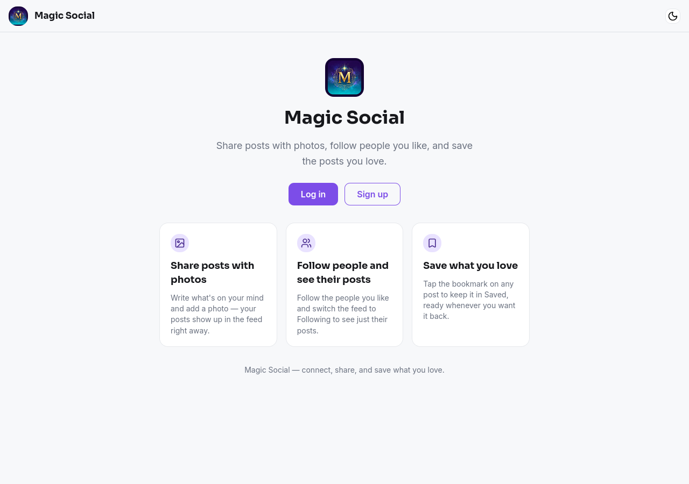
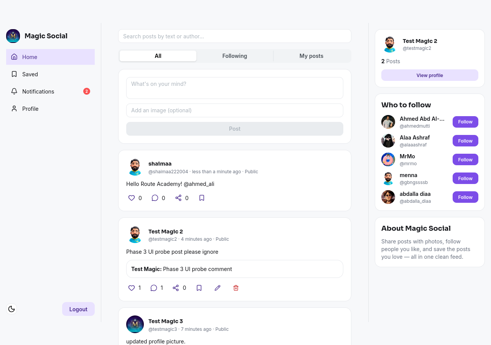
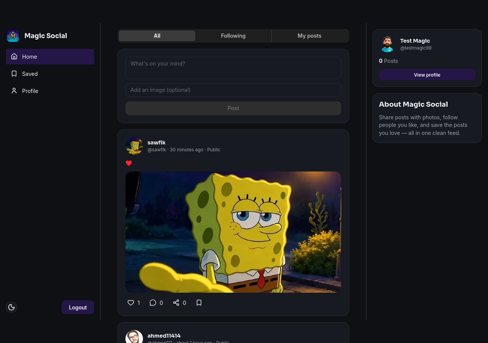
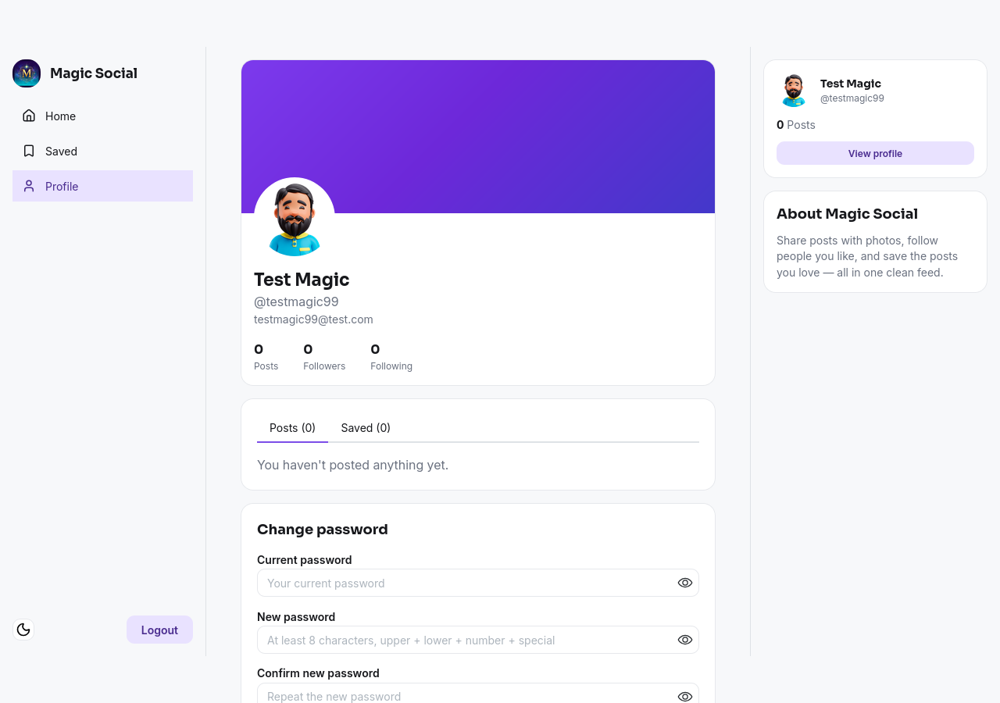
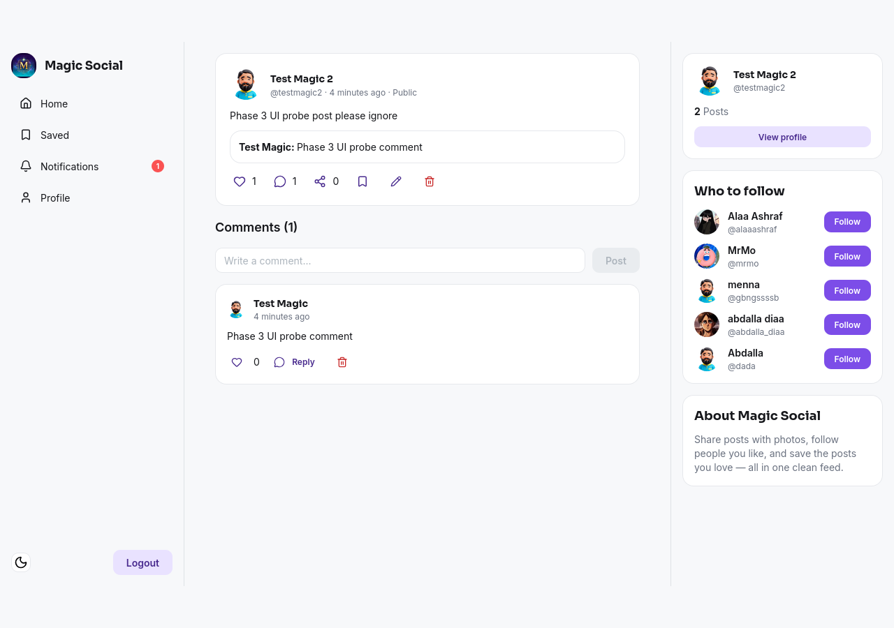
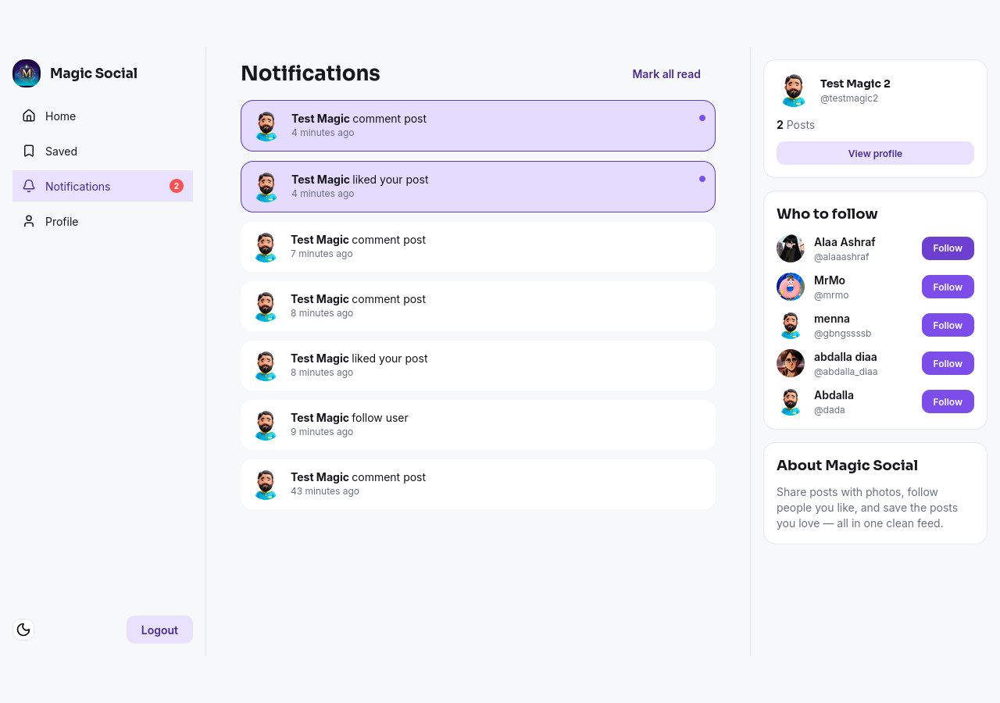
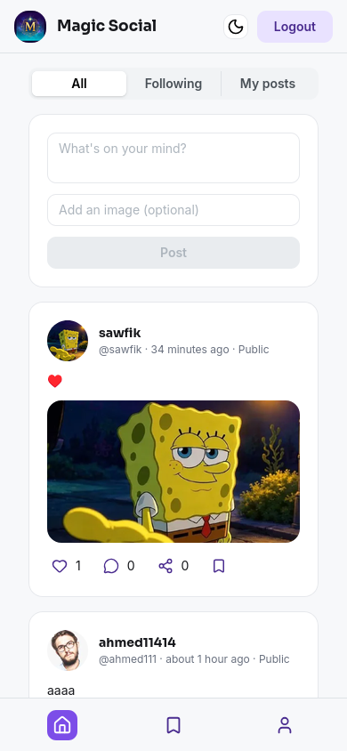
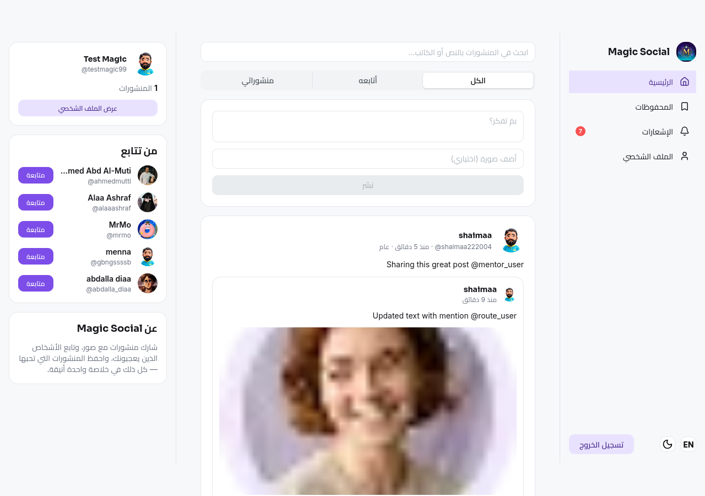

# Magic Social

A social media app — share posts with photos, follow people you like, and save the posts you love. Built with React + TypeScript for my Route Academy assignment, then upgraded for competition.

**🌐 Live demo:** https://magic-social-competition.vercel.app

## Screenshots

### Landing page



### Home feed — light & dark





### Profile



### Post details & comments



### Notifications



### Mobile feed



### Arabic / RTL



## Features

### Required (Route Academy assignment)

- **Sign up** — create an account with name, email and password
- **Log in** — stay signed in across visits
- **Home feed** — all posts, newest first
- **Post details + comments** — open any post to read and join the discussion
- **Profile** — your posts, followers and following, plus your saved posts
- **Post CRUD** — create, edit and delete your own posts (text + image)
- **Comment CRUD** — add, edit and delete your own comments
- **Change password** — from your profile, and you stay logged in after

### Upgrades

- **Likes** — like posts and comments, with a likers list on every post
- **Bookmarks** — save posts to a Saved page
- **Share** — copy a post's link to share it anywhere
- **Feed filters** — All / Following / My posts
- **Infinite scroll** — more posts load as you scroll
- **Image change on edit** — swap a post's photo when editing it
- **Suggestions + follow** — "Who to follow" and follow/unfollow on any profile
- **Profile-photo upload** — change your avatar from your profile
- **Notifications** — likes, comments and follows, with an unread badge and "Mark all read"
- **Public profiles** — visit any user's profile and see their posts
- **Threaded replies** — reply to a comment, nested under it
- **Search** — find posts by text or author
- **Dark / light mode** — one tap, remembered across visits
- **Full Arabic / RTL** — English ↔ Arabic toggle, whole layout flips right-to-left
- **PWA** — installable on phone and desktop, works like a real app
- **Landing page** — cinematic glass showcase for logged-out visitors
- **Explore page** — photo grid of image posts
- **Trending hashtags** — top tags from loaded posts, click to search
- **Followers / Following lists** — click the counts on any profile
- **Profile stats** — likes received, posts, followers, following
- **Cinematic glass design** — glass cards, gradient-mesh backdrop with drifting orbs, Sora headings, light + dark
- **Top navbar** — sticky glass bar with search, notifications bell with unread badge, New post button, and an avatar menu (View profile / Change password / Log out)
- **Back to top** — floating glass button that appears as you scroll
- **Create anywhere** — the composer opens as a modal from the navbar or the sidebar, from any page

## Tech stack

- **React 19** + **TypeScript** + **Vite**
- **Mantine** — UI components and theming
- **TanStack Query** — data fetching and caching
- **React Router** — navigation
- **React Hook Form + Zod** — forms and validation
- **axios** — API calls
- **Lucide** — icons

## Getting started

```bash
npm install
npm run dev
```

Open http://localhost:5173.

```bash
npm run build   # production build
npm run lint    # eslint
```

## API

All data comes from the **Route Academy Linked Posts API**:

- Base URL: https://route-posts.routemisr.com/
- Docs: https://documenter.getpostman.com/view/5709532/2sBXcBnNAq

The app signs in with email + password and keeps the auth token in `localStorage`. No secrets live in this repo.

## Project structure

```
src/
├── api/            # one folder per feature: Auth, Posts (+ Comments), Profile, Users, Notifications
├── pages/          # Landing, Auth, Home, Explore, Posts, Profile, Users, Notifications
├── components/     # PostCard, Composer, CreatePostModal, AccountMenu, BackToTop, LikersModal, SuggestionsCard, FollowButton, TrendingCard, …
├── context/        # Auth + Language providers
├── i18n/           # English/Arabic dictionary
├── theme.ts        # Mantine theme (light/dark, cinematic glass style)
└── types.ts        # shared types
```

## Notes

- This is a student project for Route Academy — the API, accounts and posts are shared with the course.
- Screenshots in `docs/screenshots/` were taken from the live app with test accounts.
